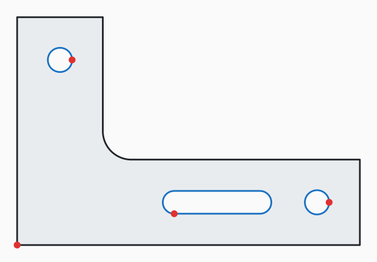
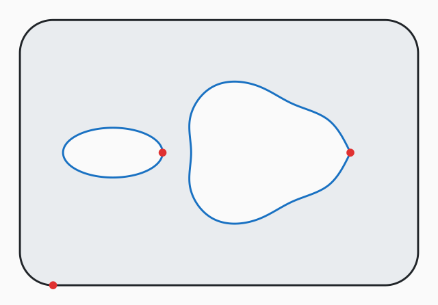

# DXF Part Calculator

Get **cut length, pierce count, part area and a rough quote** from DXF files in one command.
Built for laser, plasma, waterjet and CNC router shops that quote from customer drawings,
and for developers building instant quoting into a website or ERP.

Plain .NET 8, no dependencies. Text, JSON and SVG preview output.

[](https://github.com/softechies/dxf-part-calculator/actions/workflows/build.yml)


<p>
  
  
</p>

*Previews from `--svg`: part outline in black, holes in blue, open paths dashed orange, pierce points in red.*

## Example

```text
$ dxfcalc samples/bracket.dxf --speed 3000 --pierce 0.8 --rate 90 --material 45 --qty 10

File            bracket.dxf
Units           mm
Size            120.00 x 80.00 mm
Cut length      534.25 mm
Pierces         4  (1 outer, 3 holes, 0 open)
Part area       4,717.83 mm²  (47.18 cm²)
Bounding area   9,600.00 mm²
Utilisation     49.1 % of the bounding rectangle
Entities        CIRCLE 2, LWPOLYLINE 2
Skipped         DIMENSION 1, TEXT 1

Cut time        0.23 min each
Machine         0.35 each
Material        0.43 each (bounding rectangle)
Total           0.78 each, 7.79 for 10
```

Pass several files or a folder and you also get a summary table:

```text
$ dxfcalc samples/

File                         W x H (mm)               Cut (mm)  Pierces     Area (mm²)
bracket.dxf                  120.00 x 80.00             534.25        4       4,717.83
cover-plate.dxf              152.40 x 101.60            761.69        3      12,340.47
flange.dxf                   150.00 x 150.00            885.93        8      14,165.36
Total                                                 2,181.87       15      31,223.67
```

## What it handles

| | |
|---|---|
| **Entities** | LINE, ARC, CIRCLE, LWPOLYLINE with bulges, 2D POLYLINE, ELLIPSE, SPLINE (rational NURBS), INSERT (nested, scaled, rotated, mirrored blocks) |
| **Broken outlines** | Joins separate lines and arcs into contours, in any order and direction, within a tolerance |
| **Holes and islands** | Detects nesting: outline, hole, island in a hole, so the area is the real material area |
| **Messy exports** | Removes entities and contours drawn twice, reports open contours |
| **Annotation** | Skips TEXT, MTEXT, DIMENSION, HATCH and friends; `--ignore-layers` for anything else (bend lines, notes) |
| **Units** | Reads `$INSUNITS` (mm, cm, m, in, ft...). Warns when missing, `--units` to override |
| **Mirrored geometry** | Handles object coordinate systems with a flipped extrusion, common in mirrored parts |
| **Formats** | ASCII DXF from R12 to current versions. Binary DXF is detected and rejected with a clear message |

## Accuracy

Lengths of lines, arcs, circles and bulge segments are computed exactly. Ellipses, splines and
non uniformly scaled arcs are measured on a fine polyline (chord error 0.002 mm by default).
On the samples, results agree with hand calculation to within 0.003%.

| Sample | Expected cut length | dxfcalc |
|---|---|---|
| `flange.dxf` (Ø150, Ø60 bore, 6 x Ø12 via block inserts) | 885.93 mm | 885.93 mm |
| `bracket.dxf` (L bracket, R10 fillet, 2 holes, slot) | 534.25 mm | 534.25 mm |

## Options

```
dxfcalc <file.dxf | folder> [...] [options]

Analysis
  --units <mm|cm|m|in|ft>     override the drawing units
  --ignore-layers <a,b,...>   skip layers, wildcards allowed: "DIM*,TEXT,BEND"
  --join-tolerance <mm>       max gap when joining entities (default 0.05)
  --svg <file|folder>         write a preview SVG
  --json                      machine readable output

Quote
  --speed <mm/min>            cutting speed for the material and thickness (required for a quote)
  --pierce <seconds>          time per pierce (default 0.5)
  --rate <per hour>           machine rate
  --material <per m²>         sheet price, charged on the bounding rectangle
  --qty <n>                   quantity
```

How the quote works: `cut minutes = cut length / speed + pierces × pierce time`,
machine cost from the hourly rate, material from the bounding rectangle area. It is deliberately
simple; real nesting and per material tables are a natural next step.

## Using it from code

The analysis is a library behind a thin CLI:

```csharp
var part = PartAnalyzer.Analyze("bracket.dxf", new AnalysisOptions { IgnoreLayers = ["BEND*"] });

Console.WriteLine($"{part.CutLengthMm:F1} mm, {part.Pierces} pierces, {part.NetAreaMm2:F0} mm²");

var quote = QuoteCalculator.Calculate(part, new QuoteOptions
{
    CutSpeedMmPerMin = 3000, PierceSeconds = 0.8, RatePerHour = 90, MaterialPerM2 = 45
});
```

That makes it easy to put behind an ASP.NET endpoint for an upload and instant quote page.

## Build and test

```bash
git clone https://github.com/softechies/dxf-part-calculator.git
cd dxf-part-calculator
dotnet test
dotnet run --project src/DxfPartCalculator -- samples/flange.dxf
```

The sample files are generated by [`samples/generate_samples.py`](samples/generate_samples.py) using
[ezdxf](https://github.com/mozman/ezdxf), so the tests run against output from an independent DXF writer.

## Project layout

```
src/DxfPartCalculator/
  Dxf/         ASCII DXF reader: header, blocks, entities
  Geometry/    transforms, arcs, bulges, ellipses, NURBS, entity conversion
  Analysis/    contour joining, nesting, area, duplicates, quote
  Output/      text, JSON and SVG reports
tests/         geometry, analyzer and sample file tests
samples/       example parts and the script that generates them
```

## License

MIT

---

Built and maintained by [Softechies Solutions](https://softechies.net). We build CAD/CAM utilities,
instant quoting portals and manufacturing software in .NET and on the web.
